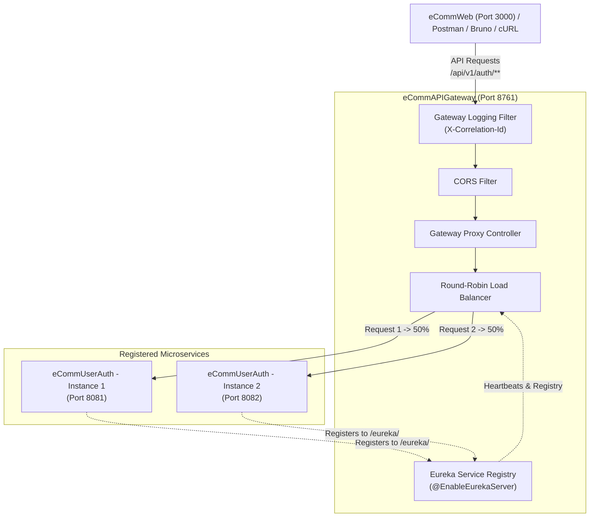

# eCommAPIGateway - API Gateway, Eureka Registry & Load Balancer

A modern, production-grade Spring Boot 3 API Gateway, Netflix Eureka Service Discovery Registry, and Client-Side Load Balancer for the E-Commerce Microservices ecosystem.

---

## 🌟 Key Architecture & Capabilities



1. **Netflix Eureka Service Registry (`@EnableEurekaServer`)**:
   - Central discovery hub for all microservices on port `8761`.
   - Browser-based Eureka Dashboard at `http://localhost:8761/`.
   - Registration endpoint for downstream services: `http://localhost:8761/eureka/`.

2. **API Gateway Reverse Proxy**:
   - Single point of entry for all e-commerce client traffic (`eCommWeb` on port 3000, mobile apps, or Postman).
   - Routes:
     - `/api/v1/auth/**` & `/api/auth/**` -> forwards to `eCommUserAuth`
     - `/api/v1/users/**` & `/api/users/**` -> forwards to `eCommUserAuth`
     - `/ecommuserauth/**` -> service-prefixed routing
     - `/services/{serviceId}/**` -> dynamic routing to any service registered with Eureka
   - Forwards HTTP method, URI, query parameters, authorization headers (JWT Bearer tokens), and request payload.

3. **Client-Side Load Balancer**:
   - Round-Robin distribution across multiple registered instances of `eCommUserAuth`.
   - Only routes to instances with health status `InstanceStatus.UP`.
   - Returns `X-LoadBalanced-Instance` and `X-LoadBalanced-Instance-Id` headers so you can verify which instance answered each request!

4. **Monitoring & Introspection Endpoints**:
   - `GET /gateway/routes` - View all configured gateway routes.
   - `GET /gateway/instances` - View real-time registered services and their healthy nodes.
   - `GET /gateway/info` - Overview of gateway uptime and strategy.
   - `GET /actuator/health` - Actuator health check.

---

## 📁 Project Structure

```
eCommAPIGateway/
├── pom.xml                                     # Spring Boot 3.3.5 & Spring Cloud 2023.0.3 dependencies
├── .project                                    # STS / Eclipse project configuration
├── .classpath                                  # Eclipse classpath definition
├── .settings/                                  # Java 21 compiler & m2e IDE preferences
├── src/
│   ├── main/
│   │   ├── java/com/ecomm/gateway/
│   │   │   ├── ECommApiGatewayApplication.java # Spring Boot entry point + @EnableEurekaServer
│   │   │   ├── config/
│   │   │   │   ├── CorsConfig.java             # Cross-Origin Resource Sharing filter
│   │   │   │   ├── EurekaConfig.java           # Guaranteed ApplicationInfoManager bean setup
│   │   │   │   ├── GatewayProperties.java      # Config properties for routing & load balancer
│   │   │   │   └── HttpClientConfig.java       # RestTemplate bean with pass-through error handling
│   │   │   ├── controller/
│   │   │   │   ├── GatewayDashboardController.java # /gateway/routes & /gateway/instances
│   │   │   │   └── GatewayProxyController.java # Core proxy routing & load balancing controller
│   │   │   ├── filter/
│   │   │   │   └── GatewayLoggingFilter.java   # X-Correlation-Id & latency tracking filter
│   │   │   └── loadbalancer/
│   │   │       ├── LoadBalancerService.java    # Load balancer contract
│   │   │       ├── EurekaLoadBalancerServiceImpl.java # Round-Robin load balancer via Eureka
│   │   │       └── ServiceInstanceInfo.java    # Service instance metadata DTO
│   │   └── resources/
│   │       ├── application.properties          # Server port 8761, Eureka, & Gateway settings
│   │       └── banner.txt                      # Startup ASCII banner
│   └── test/
│       ├── java/com/ecomm/gateway/
│       │   └── ECommApiGatewayApplicationTests.java # Context load test
│       └── resources/
│           └── application.properties          # Test configuration
└── README.md
```

---

## 🚦 Port Allocation

| Component | Port | Description |
|-----------|------|-------------|
| **eCommWeb** | `3000` | React + Vite + Tailwind CSS Web Frontend |
| **eCommAPIGateway** | `8761` | API Gateway, Eureka Server Dashboard, & Load Balancer |
| **eCommUserAuth (Instance 1)** | `8081` | User Authentication Microservice |
| **eCommUserAuth (Instance 2)** | `8082` | Scaled second instance for load balancing testing |

---

## 🛠️ Step-by-Step Setup in Spring Tool Suite (STS)

### 1. Import `eCommAPIGateway` into STS
1. Open **Spring Tool Suite (STS)**.
2. Click **File** -> **Import...** -> **Maven** -> **Existing Maven Projects**.
3. Browse to `C:\Users\NADEEM\STS_NoorAI\eCommAPIGateway` and click **Finish**.
4. Right-click the project -> **Maven** -> **Update Project...** -> Click **OK**.

### 2. Start `eCommAPIGateway`
1. Right-click on `eCommAPIGateway` in STS Project Explorer.
2. Select **Run As** -> **Spring Boot App**.
3. Open your browser and navigate to: `http://localhost:8761/`. You will see the **Spring Eureka Dashboard**.

### 3. Start `eCommUserAuth` (Port 8081)
1. Right-click on `eCommUserAuth` project.
2. Select **Run As** -> **Spring Boot App**.
3. Refresh `http://localhost:8761/` in your browser. You will see `ECOMMUSERAUTH` listed under **Instances currently registered with Eureka**!

---

## 🧪 Testing the APIs via Gateway

### 1. Register a User via Gateway
```bash
curl -X POST http://localhost:8761/api/v1/auth/register \
  -H "Content-Type: application/json" \
  -d '{
    "name": "Nadeem",
    "email": "nadeem@example.com",
    "password": "Password@123",
    "role": "ROLE_USER"
  }'
```

### 2. Login via Gateway
```bash
curl -X POST http://localhost:8761/api/v1/auth/login \
  -H "Content-Type: application/json" \
  -d '{
    "email": "nadeem@example.com",
    "password": "Password@123"
  }'
```

### 3. Verify Response Headers
In the response headers, observe:
- `X-LoadBalanced-Instance: http://localhost:8081`
- `X-Correlation-Id: <uuid>`
- `X-Gateway-Duration-Ms: <duration>`
